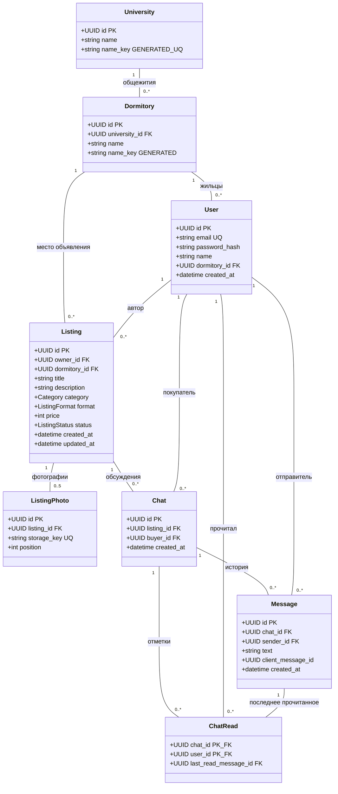

# Диаграмма классов базы данных

Диаграмма отражает 8 текущих моделей SQLAlchemy из `src/models`. Общие поля Base/mixins показаны внутри сущностей; классы-наследники и перечисления не вынесены в отдельные таблицы.

`PK` — первичный ключ, `FK` — внешний ключ, `UQ` — уникальное поле, `GENERATED` — вычисляемое БД поле. `1` означает одну запись, `0..*` — от нуля до множества записей.

Составные ограничения:

- Dormitory: UNIQUE `(university_id, name_key)`.
- ListingPhoto: UNIQUE `(listing_id, position)` и CHECK позиции 0–4.
- Chat: UNIQUE `(listing_id, buyer_id)`.
- Message: UNIQUE `(chat_id, sender_id, client_message_id)` и `(id, chat_id)`.
- ChatRead: PK `(chat_id, user_id)` и составной FK `(last_read_message_id, chat_id)` → Message `(id, chat_id)`.

Автор чата определяется через `Chat.listing.owner`, отдельно в Chat не дублируется. Последнее сообщение и количество непрочитанных вычисляются запросом.

Диаграмма показывает физические связи моделей. Правило «только два участника чата» проверяется будущим сервисом, а не количеством строк ChatRead: схема сама не ограничивает их двумя. Для ListingPhoto предел 5 обеспечен уже ограничениями БД. Подробные типы, CHECK и правила удаления приведены в [database.md](database.md).
